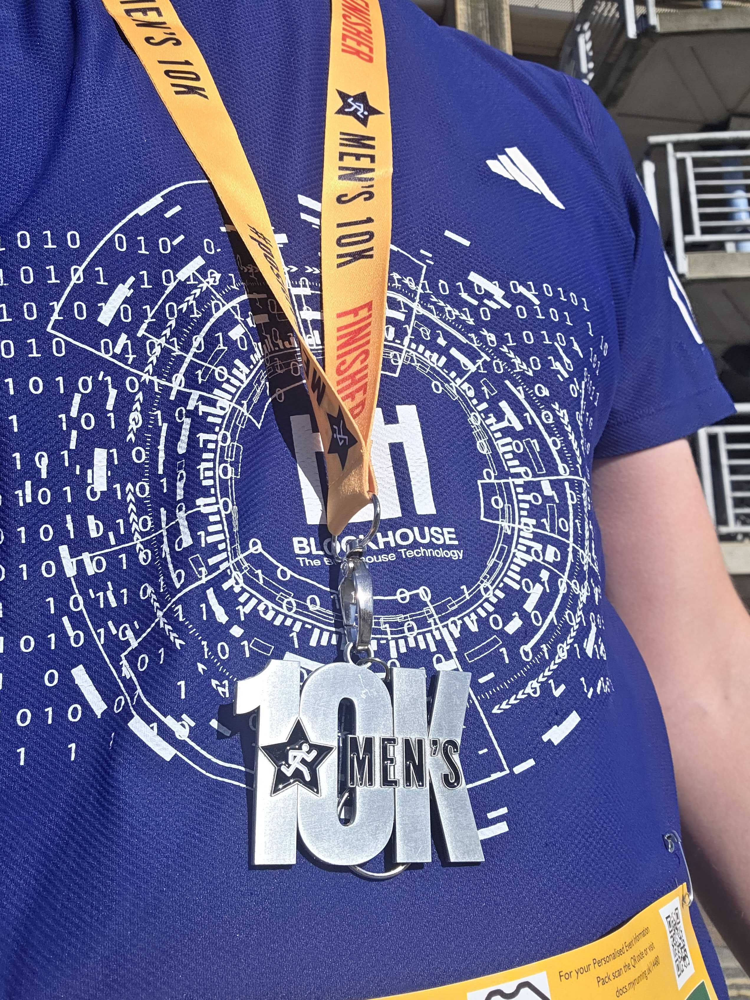
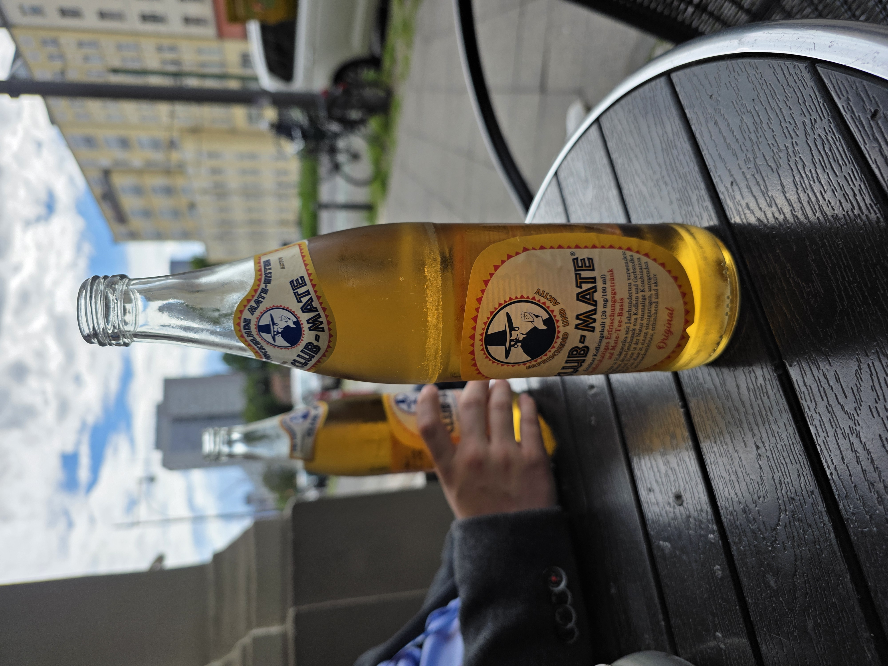
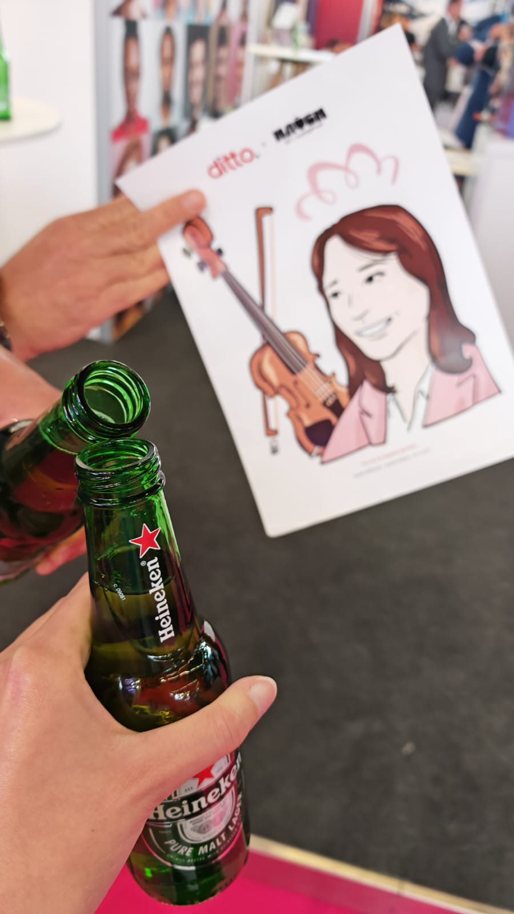
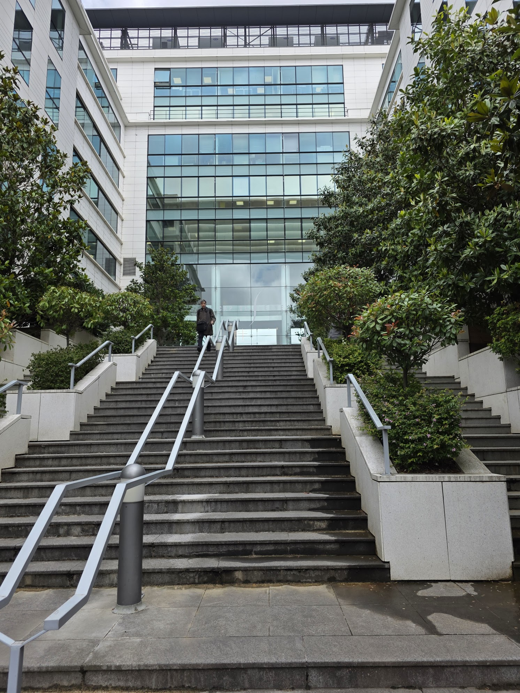

----
[<- Home](../../)
### TL;DR

**Flag**

```
FortID{Y0u_H4v3_N0w_B3com3_4_C3rt1fi3d_0p3n_50urc3_1n73l1genc3_Gr4ndM45t3r_4_L1f3_9fd1966b7c}
```

NO TL;DR for this one. 
### Details

**Description:** We regret to inform you that the OSINT certification you've received [last year](https://github.com/blockhousetech/TBTL-CTF/tree/master/2025/Misc/osint_exam/) has expired.

You can renew your certification by passing our new OSINT exam.

**Author:** ipaljak

**Files:** src/data.zip

## Walkthrough

```bash
$ ll
total 7404
drwxr-xr-x 1 user user      98 Oct  9 22:41 .
drwxr-xr-x 1 user user      26 Oct  9 22:41 ..
-rw-rw-r-- 1 user user 1205226 Sep 29 13:12 q1.png
-rw-rw-r-- 1 user user 3156105 Sep 29 14:15 q2.jpg
-rw-rw-r-- 1 user user  101094 Oct  8 14:06 q3.jpeg
-rw-rw-r-- 1 user user  930292 Sep 29 14:04 q5.jpg
-rw-rw-r-- 1 user user 1981929 Sep 29 13:34 q6.mp4
-rw-rw-r-- 1 user user  108646 Sep 29 13:28 q6_1.jpeg
-rw-rw-r-- 1 user user   83893 Sep 30 14:19 q6_2.jpeg

```
### Question 1

`q1.png` depicts one of our team members after finishing a race. What city was the race at, what was their bib number, and what was their finish time (hh:mm:ss)?

Format: \<city> <bib_number> <chip_time> (e.g. New York 12345 11:22:33)



EXIF Metadata

```
File Modification Date/Time     : 2026:09:29 13:12:40+00:00
File Access Date/Time           : 2026:10:09 22:43:36+00:00
File Inode Change Date/Time     : 2026:10:09 22:41:10+00:00
```

[Men's 10k results](https://www.mens10k.com/results)

Found a similar-loking ladder (right corner of the photo).


That points to Murrayfield, Edinburgh

As per my understanding, these numbers are connected to runners = bib number.


Used this city to get the results.
https://www.mens10k.com/results?age_category=any&event=1070&gender=M&rs=451&running_number=14480


Answer:

```
Edinburgh 14480 00:53:14
```

### Question 2

This year we had a booth at one of the largest European identity conferences and we had a great time as you can see in `q2.jpg`. What was the name of the talk that one of our members gave?

Format: `<talk_title>` (e.g. `On the Navier-Stokes Millennium Prize Problem`)



```
Create Date                     : 2026:05:20 16:34:58.588
Date/Time Original              : 2026:05:20 16:34:58.588+02:00
Modify Date                     : 2026:05:20 16:34:58.588+02:00
```


 One of the largest European identity conferences + Berlin + May 20  $\implies$  European Identity & Cloud Conference (EIC)

https://www.kuppingercole.com/events/eic2026/agenda
https://www.kuppingercole.com/sessions/6050/1


Answer:
```
From EU Digital Identity Architecture to Real-World Services
```

### Question 3

When conferencing in Amsterdam, enjoying a Heineken is a must! As you can see in <q3.jpeg>, one of our team members even got a sketch of themselves. The piece (concerto) of which composer did they play during their final exam in music school? Can you also find the address of the apartments they are renting on the Croatian coastline?

Format: `<composer_name> <street> <apt. no.> <postal_code> <city> <country> (e.g. Antonio Vivaldi Zinke Kunc 42 42000 Varazdin Croatia)`



The sketch led me to Ditto:
https://es.linkedin.com/company/ditto-id
https://www.ditto.id/


Then found an artist - [Hatch](https://www.hatch-art.com/shop/a-day-in-the-sun)

And the conference -- [Identity Week](https://www.linkedin.com/company/identityweek/).

https://www.linkedin.com/posts/gonzoalonso_these-are-some-of-the-portraits-hatch-captured-activity-7470868418506768384-1KEd


Got stuck here. Even checked the prev OSINT Exam.

https://github.com/blockhousetech/TBTL-CTF/blob/master/2025/Misc/osint_exam/solution/README.md

Found mention of this page: https://tbtl.com/meet-the-team/


Checked it on the webarchive 
http://web.archive.org/web/20250708010413/https://tbtl.com/meet-the-team/

Nothing really clicked.. 

So I started checking team members from Croatia on Linkedin


"Lara Grgurić". At first, I didn't think it was her.

But after some searching:
https://www.youtube.com/watch?v=KhDSagECrO0

https://www.youtube.com/watch?v=r3VTVYtMmMI
https://www.facebook.com/gsimrijeka/videos/lara-grguri%C4%87-1-r-og%C5%A1i-kordi%C4%87-zaigrana-sonatina-i-stmentorica-dora-lovre%C4%8Di%C4%87-prof/303484331055050/


cc: https://ezadar.net.hr/kultura/418523/dva-prva-mjesta-ucenika-glazbene-skole-blagoje-bersa-na-medjunarodnim-natjecanjima/


cc: https://ezadar.net.hr/kultura/376183/u-nedjelju-natjecanje-gudaca-u-glazbenoj-skoli-blagoje-bersa/

Found blogpost where (assumed) she was standing with a violin. 


cc: https://lnkd.in/p/dumHky6t

On youtube name led me to this channel:  


cc: https://www.youtube.com/@laragrguric2621/videos

And one of the videos has the following description:

```
Footage of Lara Grgurić's final exam, 4.6.2020..
```
cc: https://www.youtube.com/watch?v=1BkjYfSvP_8

So, it is `M. Bruch Violin Concerto No. 1 in G minor, op 26, 2nd and 3rd movement`

First part of the answer - `Max Bruch`

Assumption. Next search:  `"Lara Grgurić Croatia"`


\

nvm.. it's in NY

Found a fb profile:
https://www.facebook.com/people/Lara-Grguri%C4%87/pfbid02jhCuUNAAqAe3gFEhLfQRPUQXwJFvboqZpJRdmJ8uZYJrjMECizQXDdNi2guiBpxMl/


Place: Pag, Croatia


Another search: 

```
"Grguric" "Croatia" "rent"
```

One of the first results go this airbnb listing:
https://www.airbnb.com.ua/rooms/903690801760017577

Another search: 

```
"Grguric" "Pag"
```


Back to fb. Older photos showed a pool. 


The green sun lounger looks like a match.


The link to Skyscanner was no longer working, but we were able to get the name of the property from the URL:
https://www.skyscanner.gg/hotels/croatia/pag-hotels/family-apartments-grguric/ht-136392260

```
family-apartments-grguric
```

Searched for `"family-apartments-grguric"`

That led to this property listing:
https://apartments-grguric-23250.zadarhotelspage.com/en/


The photos matched the apartments.

```
Augusta Šenoe 31a, Pag, Croatia
```

So the answer should be:

```
Max Bruch Augusta Senoe 31a 23250 Pag Croatia
```

### Question 4

We have a foosball table at our office, and it has become quite competitive. Can you figure out who is the best, who is the worst, and who played the most games?

Format: `<best_player> <worst_player> <player_with_most_games> (e.g. Alice Bob Charlie)

No images for this one...

Started from their office.

First search: 

```
"fortid" "foosball"
```

This led to the FortID Blog https://fortid.com/blog/


cc: https://fortid.com/blog/foosball-fortid-integration/


The blog post even links directly to the dashboard:


https://stolni.dev.tbtl.io/leaderboard
is live


WA: https://web.archive.org/web/20261010124447/https://stolni.dev.tbtl.io/leaderboard

```
Format: <best_player> <worst_player> <player_with_most_games> (e.g. Alice Bob Charlie)
```

```
Paljak Kiki Dino
```

### Question 5


This year we have attended a handful of EUDI interoperability events. The venue for one of them is shown in <q5.jpg>. After that event finished, one of our team members had enough time to jump on a train and compete in a CTF final event the next morning. What is the name of the interoperability event venue, what city were the CTF finals held, and what is the name of that CTF?

Format: `<event_venue> <CTF_city> <CTF_name> (e.g. Stamford Bridge Las Vegas DEF CON CTF)`


loc: ~~Cap de Seine~~ **Docaposte**, Ivry-sur-Seine, France, `48.819014, 2.398341`

One possible match was [Midnight Flag CTF 2026](https://midnightflag.fr/) in Rennes


Around the same time, EUDI Unfold was held at Docaposte near Paris


Answer:

```
Docaposte Rennes Midnight Flag CTF
```


### Question 6

On the last day of our team building, we drove some Land Rovers in the morning (`q6.mp4`), then had a few pints at a pub, and decided to do some hiking (`q6_1.jpeg` and `q6_2.jpeg`) after the pub closed down. What is the name of the peak we were hiking towards?

Format: `<peak_name>` (e.g. `Mount Everest`)

Questions started with:
- Where was the team-building event?
- Which pub did they visit? and should I even search for that.
- And, obviously, what was the peak?

Maybe someone on the team posted photos from that day on instgram

Started with searches like "oxford land rovers jeeping"


Yellow rear plates + white front plates + right side $\implies$ Great Britain

Tried board searches like `"where in gb near oxford go on offroad ride on range rovers"`

Found several official locations offering that from Land Rover Experience. 


This one caught my attention because of the older defenders.


And it was near Oxford


and they are driving some kind of ex-milatry (?) Defender soft-top ? 
possibly 110s


Or LR Defender 90 aka Land Rover Wolf 


cc: https://www.forgedmotors.co.uk/vehicle-details/used-land-rover-defender-90-2-5-soft-top-for-sale-dry-ice-blasting-u64/

At 00:12 noticed red lines and some text on the windscreen.

`???OAO?` maybe OFFROAD + maybe ADVENTURES


Next, checked what team members had posted

Dino Santl looked promising. He is from Croatia and had posted some photos from England recently. Loc: windermere lake district


cc: https://www.instagram.com/p/DdznnxhAs1n/?img_index=11

One photo looked somewhat similar to the rocky terrain in `q6_2.jpeg`.


Looked for local defender off-road operator and found KANKKU: https://www.kankku.co.uk/

That would explain the `KK` lettering on the windscreen.


and yes, they use ex-mill defs


https://maps.app.goo.gl/qcYRWo42DPjnYvnn7
their map point `54.380170, -2.905059`

Now for the peak.

When reverse searching this image with "windermere lake" as a request


Found this video


cc: https://www.youtube.com/watch?v=nr0LGv_zhF4

The rocks looked kinda similar. 


So I checked Brant Fell, and it was it

Answer:

```
Brant Fell
```

Flag:
```
FortID{Y0u_H4v3_N0w_B3com3_4_C3rt1fi3d_0p3n_50urc3_1n73l1genc3_Gr4ndM45t3r_4_L1f3_9fd1966b7c}
```